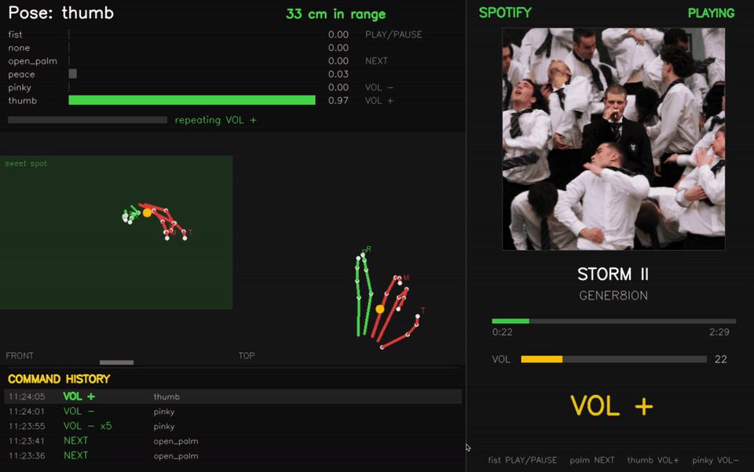

# Leap Motion Pose Control for Spotify

Control Spotify with hand poses, using an original Leap Motion Controller and a
small machine learning model trained in Edge Impulse.

Make a fist to play or pause, open your palm to skip a track, and stick out
your thumb or pinky to turn the volume up or down. Everything runs locally on
your Mac, with no camera and no cloud.



---

## Contents

- [What it does](#what-it-does)
- [How it works](#how-it-works)
- [What you need](#what-you-need)
- [Installation](#installation)
- [Quick start](#quick-start)
- [Using the app](#using-the-app)
- [Train your own model](#train-your-own-model)
- [Settings you can change](#settings-you-can-change)
- [Troubleshooting](#troubleshooting)
- [Project structure](#project-structure)
- [Other tools in this repo](#other-tools-in-this-repo)
- [Roadmap](#roadmap)
- [License](#license)

---

## What it does

| Pose | What you do | Spotify action |
| --- | --- | --- |
| **Fist** | Curl all fingers | Play / pause |
| **Open palm** | All five fingers straight | Next track |
| **Thumb** | Fist with only the thumb out | Volume up (repeats while held) |
| **Pinky** | Fist with only the little finger out | Volume down (repeats while held) |
| **Peace** | Index and middle finger up | No action yet (spare pose) |
| **None** | Anything else | Nothing |

The app also shows:

- Live confidence bars for every pose
- Your hand skeleton from the front and from above
- A large Spotify card with album art, title, artist, progress and volume
- A command history, so you can see what was sent and when
- A status line that tells you why nothing is happening (too far, unsure, relax your hand, and so on)

---

## How it works

```
Leap Motion V1  ->  Ultraleap Gemini  ->  Python (LeapC bindings)
                                                |
                                   62 hand features per frame
                                                |
                                 Edge Impulse model (TFLite)
                                                |
                       smoothing + hold + re-arm logic
                                                |
                                 Spotify (AppleScript)
```

1. **Tracking.** The Leap Motion sees your hand in 3D. Ultraleap's Gemini
   software turns that into a hand skeleton (palm plus 20 finger joints).
2. **Features.** For every frame, `pose_features.py` turns the skeleton into
   62 numbers: each finger joint's position *relative to your palm*, rotated
   to the palm's own direction and scaled by hand size, plus pinch and grab
   strength. Because everything is relative to the palm, the model doesn't
   care where your hand is or how big it is.
3. **Model.** A small neural network (62 inputs, two layers of 40 and 20
   neurons, 6 outputs) trained in Edge Impulse classifies the pose. It is
   tiny and runs easily in real time on a laptop.
4. **Decision logic.** A single frame is never enough to trigger a command:
   - The last 5 predictions are averaged.
   - The best pose must score at least 0.75.
   - It must be held for 0.6 s. Flickers shorter than 0.15 s are ignored.
   - After a command fires, you relax your hand (or move it away) to re-arm.
     A quick 0.2 s relax is enough.
   - There is a 1 s cooldown between different commands.
   - Volume poses repeat every 0.5 s while you hold them.
5. **Action.** The command is sent to the Spotify desktop app with AppleScript.
   A background thread reads what's playing (track, artist, volume, album art)
   once a second.

### Model performance

Trained on data from two people, recorded at 12 to 45 cm from the sensor,
the model reaches **98.7% validation accuracy** across the 6 classes. The
main mistakes are pinky being read as thumb (about 2.7%) and some confusion
with none.

These numbers are per frame. Live, the smoothing and hold logic remove most of
the remaining mistakes.

---

## What you need

### Hardware

- **Leap Motion Controller (V1)**, the original one
- **A Mac** (tested on Apple Silicon)
- **A cable.** The Leap V1 uses a USB 3.0 Micro-B connector (the wide one used
  by older external hard drives). A direct **USB-C to USB 3.0 Micro-B** cable
  is much more reliable than an adapter. See [Troubleshooting](#troubleshooting).
- **Optional:** a holder or clamp to fix the sensor to the edge of your desk

### Software

- macOS with the **Spotify desktop app**
- **Ultraleap Hand Tracking (Gemini)** for macOS
- **Python 3.12**. It must match the Python module that ships with Gemini.
  See [Installation](#installation).

---

## Installation

### 1. Install Ultraleap Gemini

Download and install **Ultraleap Hand Tracking** for macOS from the Ultraleap
website, then plug in the Leap Motion. Open the Ultraleap Control Panel and
check that it sees your hand.

> Keep a copy of the installer. Older Leap software can become hard to find.

### 2. Get the code

```bash
git clone https://github.com/gigwegbe/edge-impulse-gesture-control-with-leap-sensor.git
cd edge-impulse-gesture-control-with-leap-sensor
```

### 3. Create a Python environment

Recent Gemini versions ship a compiled Python module for LeapC inside the app,
named something like `_leapc_cffi.cpython-312-darwin.so`. The `312` means it
was built for Python 3.12. You can find it with:

```bash
find /Applications -name "_leapc_cffi*.so" 2>/dev/null
```

Create the virtual environment with that same Python version:

```bash
brew install python@3.12 portaudio
python3.12 -m venv .venv
source .venv/bin/activate
pip install --upgrade pip
```

### 4. Install the LeapC Python bindings

```bash
mkdir -p third_party
git clone --depth 1 https://github.com/ultraleap/leapc-python-bindings.git third_party/leapc-python-bindings
pip install -e third_party/leapc-python-bindings/leapc-python-api
```

You don't need to build `leapc_cffi` yourself. The `leap` package loads the
one that ships with Gemini.

### 5. Install the other packages

```bash
pip install cffi numpy opencv-python ai-edge-litert
```

If `ai-edge-litert` doesn't install on your machine, use `pip install tensorflow`
instead. The script picks up either one.

### 6. Check the sensor

```bash
python src/check_leap.py
```

You should see the service status, the device and live palm position when you
hold your hand over the sensor. If you see `no hand`, hold your hand 20 to 30 cm from the sensor.

---

## Quick start

1. Put your trained model at `models/pose_float32.tflite`
   (see [Train your own model](#train-your-own-model)).
2. Open Spotify and start any song.
3. Run:

```bash
caffeinate -dis python src/live_pose.py --media --fullscreen
```

- `--media` lets the app control Spotify. Without it, the app only shows what
  it *would* send.
- `--fullscreen` opens it full screen. You can also press **F** to switch.
- `caffeinate -dis` keeps your Mac from sleeping while it runs.
- Press **Q** or **Esc** to quit.

The first time, macOS asks whether your terminal may control Spotify. Click
**OK**. If you missed it, go to **System Settings > Privacy & Security >
Automation** and allow it.

---

## Using the app

### Tips for reliable control

- **Keep your hand 12 to 45 cm from the sensor**, roughly in front of it. The
  distance readout turns orange when you are too close or too far.
- **Make each pose clearly**, then hold it still for about half a second.
- **Relax your hand between commands.** To pause and then play again, make a
  fist, relax, then make a fist again.
- **For volume, keep holding** the thumb or pinky. It steps every half second.
- **One hand at a time.** The app uses the first hand it sees.

### Reading the screen

**Left side**

- **Pose:** the pose that was last confirmed.
- **Bars:** the model's confidence for each pose. Green means above the
  threshold. The action for each pose is shown on the right.
- **Progress bar and status line:** the progress bar fills while you hold a
  pose. The status line tells you what the app is waiting for:

| Status | Meaning |
| --- | --- |
| `ready` | Waiting for a pose |
| `holding fist...` | Keep holding, the bar is filling |
| `repeating VOL +` | Volume is stepping while you hold |
| `relax your hand to fire again` | The command was sent. Relax to re-arm |
| `unsure: thumb 0.68` | The model isn't confident. Make the pose clearer |
| `TOO CLOSE` / `TOO FAR` | Move your hand into range |
| `no hand` | The sensor doesn't see a hand |

- **FRONT / TOP views:** your hand skeleton. Green fingers are extended and
  red ones are curled. The green band is the comfortable distance range.
- **Command history:** the last commands with time and pose. Repeated volume
  steps are grouped, for example `VOL + x3`.

**Right side**

- Spotify's state (PLAYING / PAUSED), album art, track, artist, progress and
  volume.
- The cover dims with a pause symbol when the music is paused.
- The last command flashes in large text for two seconds.

---

## Train your own model

You can retrain the model with your own hands, or add new poses.

### 1. Record poses

```bash
python src/pose_record.py
```

A window opens with your hand skeleton.

- Press **1 to 6** to choose the pose, **Space** to start and stop recording
  (after a 3 second countdown), and **Q** to quit.
- Samples are only saved while your hand is in range. The window shows how
  many you have at **near**, **mid** and **far** distance. Try to fill all three.
- Aim for **about 650 samples per pose**, about 30 seconds each at 20 per second.
- **While recording, move slowly:** tilt and rotate your hand, move it left and
  right, closer and further. That teaches the model the pose, not one exact
  position.
- Data is saved to `data/poses/poses_<date>_<time>.csv`.

To record only some poses, for example after adding new ones:

```bash
python src/pose_record.py --poses thumb,pinky
```

**Recording "none" well matters most.** Use shapes that are clearly *not* one
of the poses: half-curled fingers, pointing, three fingers, a relaxed claw,
slow transitions. Avoid nearly open hands and loose fists. Those confuse the
model with open palm and fist.

If you recorded a few seconds by mistake, `src/trim_poses.py` removes the last
N rows of one label and keeps a `.bak` backup of the original file. See the top
of the script for usage.

### 2. Upload to Edge Impulse

1. Create a project at [studio.edgeimpulse.com](https://studio.edgeimpulse.com).
2. Go to **Data acquisition > CSV Wizard** and upload one of your CSV files:
   - **Is this time series data?** No
   - **Label column:** `label`
   - **Values:** `f0` to `f61`
3. Go back to **Data acquisition > Add data > Upload data**, choose your CSV
   files, and select **Automatically split between training and testing** with
   the label taken from the file.

If a file uploads as one single sample, the wizard settings weren't applied.
Delete that sample, run the CSV Wizard again, and upload once more.

### 3. Design and train

1. **Create impulse:** input of 62 features, then a **Raw data** processing
   block, then a **Classification** learning block. Save.
2. **Raw data:** click **Generate features**. The feature explorer shows how
   well the poses separate.
3. **Classifier:** dense layers of **40** and **20** neurons, 30 to 50 training
   cycles. Click **Train**.
4. **Model testing:** click **Classify all** to check accuracy on the held-out data.

### 4. Download and use the model

On the **Dashboard**, download **Classifier model, TensorFlow Lite (float32)**
and save it as:

```
models/pose_float32.tflite
```

The app expects six classes in alphabetical order:
`fist, none, open_palm, peace, pinky, thumb`. If your model has different
classes, pass them with `--labels` in alphabetical order:

```bash
python src/live_pose.py --media --labels fist,none,open_palm,peace
```

### Adding or changing poses

1. Add the pose name to `ALL_POSES` and `HINTS` in `src/pose_record.py`.
2. Record it and retrain.
3. Add an action for it in `ACTIONS` at the top of `src/live_pose.py`. Each
   entry is `"pose": (AppleScript command, label shown on screen, repeats while held)`.

**Pick poses that differ by at least two fingers** from the existing ones.
The features are relative to the palm, so they ignore how your hand is turned.
That means *thumbs up* and *thumbs down* look the same to the model, which is
why volume down uses the pinky.

---

## Settings you can change

All are options to `src/live_pose.py`:

| Option | Default | What it does |
| --- | --- | --- |
| `--media` | off | Send commands to Spotify |
| `--fullscreen` | off | Start full screen (or press F) |
| `--model` | `models/pose_float32.tflite` | Path to the TFLite model |
| `--labels` | the 6 poses | Model classes, in alphabetical order |
| `--threshold` | 0.75 | Minimum confidence. Lower is more sensitive |
| `--hold` | 0.6 (0.4 without `--media`) | Seconds a pose must be held |
| `--none-hold` | 0.2 | Seconds of relaxed hand needed to re-arm |
| `--grace` | 0.15 | Ignore flickers shorter than this |
| `--smooth` | 5 | Number of frames averaged |
| `--cooldown` | 1.0 | Seconds between different commands |
| `--repeat` | 0.5 | Seconds between volume steps |
| `--near` / `--far` | 120 / 450 | Allowed hand distance in mm |

At the top of `src/live_pose.py` you can also change `VOL_STEP` (volume change
per step, default 8) and `FULL_W`, `FULL_H` (window size). Set these to match
your screen's shape if full screen shows empty bars.

**Too slow to respond?** Try `--hold 0.4` or `--threshold 0.65`.
**Firing by accident?** Try `--hold 1.0` or `--threshold 0.85`.

---

## Troubleshooting

**The app doesn't respond to my hand**
Look at the status line. It tells you whether the hand is out of range, the
model is unsure, or the app is waiting for you to relax. If it says `unsure`
a lot for one pose, record more samples of that pose and retrain.

**The Leap stops working after a while and I have to unplug it**
This is usually the USB adapter. Use a direct USB-C to USB 3.0 Micro-B cable
instead of an adapter or hub. Also run the app with `caffeinate -dis` and turn
off Low Power Mode. If even the Ultraleap Control Panel doesn't see your hand,
the problem is the cable or the Leap service, not this app.

**`ModuleNotFoundError: No module named '_cffi_backend'`**
Run `pip install cffi`.

**`Cannot import leapc_cffi` or a Python version error**
Your virtual environment's Python must match the module in Gemini (for
example `cpython-312` means Python 3.12). Recreate the venv with that version.

**`The model has N classes but M labels were given`**
Your model and the label list don't match. Pass the right classes with
`--labels`, in alphabetical order.

**Spotify commands fail or nothing happens in Spotify**
Make sure the Spotify desktop app is open, and allow your terminal under
**System Settings > Privacy & Security > Automation**.

**No album art**
Check the terminal for `Album art download failed`. The cover is downloaded
from Spotify's servers, so you need an internet connection.

**"Game Mode turned on" notice**
That's macOS reacting to a full screen app. It is harmless.

**Empty bars in full screen**
Change `FULL_W, FULL_H` at the top of `src/live_pose.py` to match your
screen's shape. `1440, 900` fits a 16:10 MacBook screen.

---

## Project structure

```
src/
  live_pose.py         Live app: pose model + Spotify control + interface
  pose_record.py       Record pose samples to CSV for Edge Impulse
  pose_features.py     Hand -> 62 palm-relative features (shared by both)
  pose_detect.py       Rule-based pose detector, skeleton drawing, distance check
  trim_poses.py        Remove mistaken rows from a recording
  check_leap.py        Check that the Leap and Gemini are working
  calibrate_mount.py   Measure the sensor tilt when it sits in a clamp
  mount.py             Applies the saved tilt (config/mount.json)
  media_control.py     Media keys and Spotify helpers
  record.py, live_tflite.py, speed_gate.py, leap_features.py,
  live_classify.py     Swipe gesture tools (see below)
  air_canvas.py, air_debug.py   Air writing canvas
  visual.py            Skeleton viewer for the gesture scripts
config/                Spectral settings and mount calibration
scripts/               Linux install helpers
legacy/                The original 2023 V2 SDK sample
models/
  pose_float32.tflite  Your trained model (not included)
data/poses/            Your recordings (CSV)
docs/                  Images for this README
```

---

## Other tools in this repo

This project grew out of earlier experiments with the same sensor. They are
still here if you want to explore:

- **Swipe gestures** (`record.py`, `live_tflite.py`, `speed_gate.py`):
  motion gestures like swipe left and right, trained as time series in Edge
  Impulse. Includes a speed-based detector that ignores return strokes, and a
  segment mode that cuts gestures the same way for recording and live use.
- **Air writing canvas** (`air_canvas.py`, `air_debug.py`): write in the air
  with your fingertip and save each word as an image, as a first step towards
  handwriting recognition with TrOCR. Includes a debug mode that plots tracking
  jitter.
- **Skeleton viewer** (`visual.py`): the `--visual` option for the gesture scripts.
- **Linux setup** (`scripts/`): install scripts for Ultraleap Gemini on
  Ubuntu x64.

---

## Roadmap

- [ ] Run on an **Arduino Uno Q** or **Rubik Pi 3**, as a standalone box with
      no laptop (first, check that Gemini supports the Leap V1 on ARM Linux)
- [ ] **Spotify Web API** backend, so it works on Linux boards too
- [ ] **Arduino Modulino** feedback: Pixels for the current pose, buzzer for
      confirmation, Distance sensor for wake-up or a dimmer control
- [ ] More features: focus timer (Pomodoro), Do Not Disturb, desk lamp control
- [ ] Two-hand support

---

## Acknowledgements

- [Ultraleap](https://www.ultraleap.com/) for the Gemini hand tracking
  software and the [LeapC Python bindings](https://github.com/ultraleap/leapc-python-bindings)
- [Edge Impulse](https://edgeimpulse.com/) for data collection, training and
  model export
- Everyone who lent a hand, literally, for the training data

---

## License

MIT. See [LICENSE](LICENSE).
